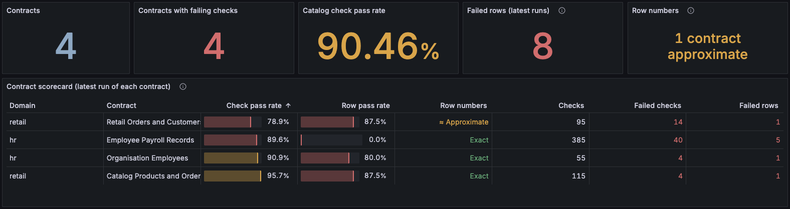

# DQ Metrics

[`dq_metrics.ipynb`](dq_metrics.ipynb) walks through the DQ metrics of a
validation run, all offline:

1. Setup and a validation run
2. Understanding the metrics
3. `dq_metrics.json`: the metrics as a file
4. OpenTelemetry: metrics, traces and logs, sent to in-memory providers
5. Seeing it in a real backend

The OpenTelemetry section needs the `[otel]` extra (`uv sync --extra otel`).
`outputs/` holds a saved `dq_metrics.json` and a sample of each OpenTelemetry
signal (`metrics.json`, `traces.json`, `logs.json`), so you can see every
shape without running anything.

## See it in Grafana

[`otel_stack/`](otel_stack/README.md) runs an OpenTelemetry Collector,
Prometheus, Tempo, Loki and Grafana on your machine with Docker. It sends
validation runs for four sample contracts and shows them on a DQ dashboard.
From the repo root:

```bash
cd examples/6_dq_metrics/otel_stack
```

```bash
make otel-up
```

```bash
make otel-add-vowl-runs
```

Then open <http://localhost:3000/d/vowl-dq>.

[](otel_stack/README.md)

See the [stack's README](otel_stack/README.md) for what runs, where the data
is kept and how to read the dashboard.

Guides: [Understanding DQ Metrics](../../docs/dq-metrics/understanding-metrics.md)
and [OpenTelemetry Export](../../docs/dq-metrics/otel-export.md).
